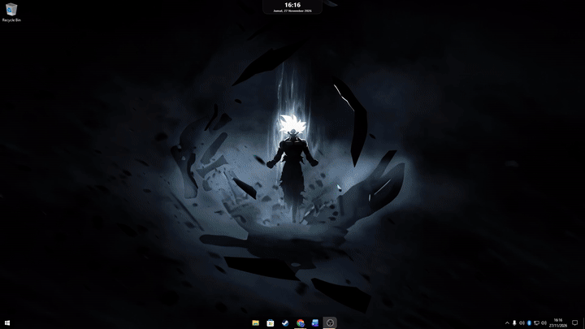
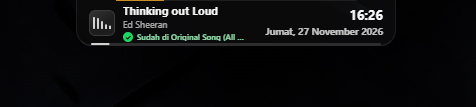
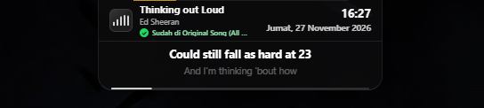
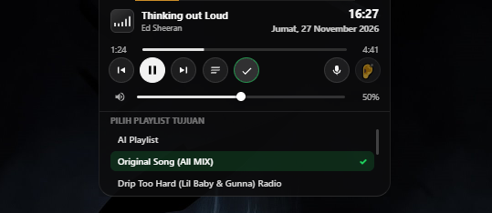
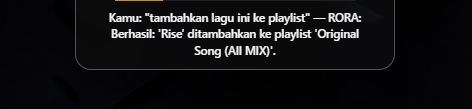

# RORA Island — Windows Dynamic Island & Offline Voice AI Assistant

**RORA Island** is a lightweight, passive Windows desktop overlay inspired by Dynamic Island, paired with an offline wake-word and speech-to-text voice assistant (**"Hey Rora"**) and two-way **Spotify Desktop** integration.

Built with **Tauri v2 (Rust)**, **Vanilla JavaScript**, **Python (openWakeWord + faster-whisper)**, and a custom **Spicetify** extension, RORA sits cleanly at the top center of your display—providing real-time media controls, synced lyrics, multi-monitor switching, and hands-free playlist management without interfering with fullscreen/borderless games.

---

## Preview & UI States

<!-- Drag & drop your compressed demo video (.mp4 under 10 MB) right below this line in GitHub's web editor -->

### Interactive Pill States

| Standby Clock Mode (`home`) | Active Media & Playlist Status (`music`) |
| :---: | :---: |
|  |  |
| **Live Synced Lyrics (`lyrics`)** | **Expanded Controls & Playlist Drawer** |
|  |  |

### Offline Voice Assistant ("Hey Rora")

| Always-On Wake Word Standby | Active Voice Listening (`6s` Window) |
| :---: | :---: |
|  |  |

| Hands-Free Command Execution Feedback |
| :---: |
|  |

---

## Key Features

- **Passive Windows SMTC Integration**: Reads Spotify playback metadata and timeline progress natively via Windows System Media Transport Controls (`Windows.Media.Control`) without touching external processes.
- **Synced & Plain Lyrics (`LRCLIB`)**: Fetches real-time line-by-line synced `.lrc` lyrics (with plain-text fallback and instrumental detection) from `lrclib.net`, caching results locally in `app_data_dir` for offline playback.
- **Offline Wake-Word & Voice Commands**:
  - Custom `"Hey Rora"` ONNX wake-word listener powered by **openWakeWord** (`16 kHz` audio stream).
  - Global hotkey trigger (`Alt + \``) alongside hands-free voice activation.
  - Local speech transcription via **faster-whisper** (`tiny`, `int8` CPU) supporting Indonesian commands such as *"Tolong tambahkan lagu ini ke playlist"*.
- **Two-Way Spotify Desktop Bridge (`Spicetify`)**:
  - Real-time playlist membership indicator (`✓` already in playlist / `+` not yet added).
  - Short-click `+` to add the current track immediately; long-press (`420 ms`) or right-click `+` to switch target playlists.
  - Direct Spotify internal volume slider with mute toggle and mouse-wheel adjustment.
- **Multi-Monitor & Adaptive Pill States**:
  - Right-click context menu to switch between connected monitors or exit the application cleanly.
  - Smooth Rust-interpolated window transitions (`home`, `music`, `lyrics`, `paused`, `notify`) and automatic fallback to compact clock mode after 5 minutes of paused idle time.
- **Browser Demo Mode**: Open `src/index.html` directly in any web browser to preview the Dynamic Island animations and synced lyrics UI without installing Rust or Tauri.

---

## Anti-Cheat & Passive Design Principles

RORA Island is strictly a passive overlay window designed to stay safe alongside borderless games:
- **No memory reading** and **no DLL injection** into any game or third-party process.
- **No synthetic keyboard/mouse input** sent to active game windows.
- Reads system media sessions and sends standard OS media transport commands (`Play/Pause`, `Next`, `Previous`), identical to physical media keys on a keyboard.

---

## System Architecture

    +-------------------------------------------------------------------+
    |                     RORA Island (Tauri v2)                        |
    |  +-----------------------------+  +----------------------------+  |
    |  |   Frontend (HTML/CSS/JS)    |  |      Rust Backend          |  |
    |  | - Dynamic Island Pill UI    |  | - Windows SMTC Reader      |  |
    |  | - 60fps Progress & Lyrics   |  | - LRCLIB API + Local Cache |  |
    |  | - Playlist & Volume Drawer  |  | - Localhost Bridge (:8899) |  |
    |  +--------------+--------------+  +-----+---------------+------+  |
    +-----------------|-----------------------|---------------|---------+
                      | Tauri IPC             | Subprocess    | HTTP (127.0.0.1:8899)
                      v                       v               v
          +-----------------------+  +----------------+  +--------------------+
          |  Global Hotkey Alt+`  |  | Python Workers |  | Spotify Desktop    |
          +-----------------------+  | - openWakeWord |  | (Spicetify Plugin: |
                                     |   (hey_rora)   |  |  rora-add.js)      |
                                     | - faster-      |  +--------------------+
                                     |   whisper STT  |
                                     +----------------+

---

## Project Structure

    rora-dynamic-island/
    ├── docs/                        # UI state screenshots for documentation
    │   ├── home.png
    │   ├── music-play.png
    │   ├── music-play-lyric.png
    │   ├── music-play-playlist.png
    │   ├── wakeword-notif.png
    │   ├── RORA-listen.png
    │   └── RORA-feedback.png
    ├── src/                         # Frontend UI (HTML, CSS, Vanilla JS)
    │   ├── index.html               # Main layout & standalone browser demo entry
    │   ├── main.js                  # State machine, progress interpolation, & IPC calls
    │   └── styles.css               # Pill transitions, visualizer, & drawer styling
    ├── src-tauri/                   # Tauri v2 & Rust backend
    │   ├── src/
    │   │   ├── main.rs              # Window animations, multi-monitor, IPC & Python workers
    │   │   ├── bridge.rs            # Local HTTP bridge server (127.0.0.1:8899)
    │   │   ├── media.rs             # Windows SMTC session reader & media controls
    │   │   └── lyrics.rs            # LRCLIB client & local JSON caching
    │   ├── capabilities/
    │   ├── icons/
    │   ├── Cargo.toml
    │   └── tauri.conf.json
    ├── spicetify-extension/         # Spotify Desktop bridge extension
    │   └── rora-add.js
    ├── openwakeword_listener.py     # Custom "Hey Rora" ONNX wake-word listener
    ├── voice_stt.py                 # Offline microphone recorder & faster-whisper STT
    ├── hey_rora.onnx                # Trained ONNX wake-word model
    └── package.json

---

## Prerequisites

- **OS**: Windows 10 or Windows 11
- **WebView2 Runtime**: Pre-installed on Windows 11; on Windows 10, install [Microsoft Edge WebView2 Evergreen Runtime](https://developer.microsoft.com/en-us/microsoft-edge/webview2/)
- **C++ Build Tools**: [Visual Studio Build Tools](https://visualstudio.microsoft.com/visual-cpp-build-tools/) with the **"Desktop development with C++"** workload (required by Tauri on Windows)
- **Rust & Cargo**: Latest stable toolchain via [rustup.rs](https://rustup.rs/)
- **Node.js**: LTS version via [nodejs.org](https://nodejs.org/)
- **Python**: Python 3.10+
- **Spotify Desktop + Spicetify CLI**: Installed and initialized via [spicetify.app](https://spicetify.app/)

---

## Installation & Setup

### 1. Clone & Install Node Dependencies

    git clone https://github.com/SandyMProjects/rora-dynamic-island.git
    cd rora-dynamic-island
    npm install

### 2. Install Python Voice & Wake-Word Dependencies

    py -m pip install openwakeword faster-whisper sounddevice numpy

> **Note**: On first launch, `faster-whisper` automatically downloads the `tiny` speech model (~75 MB) and `openwakeword` caches its base embedding model locally.

### 3. Install the Spicetify Extension

Copy `spicetify-extension/rora-add.js` into your Spicetify Extensions directory and apply it:

    Copy-Item "spicetify-extension\rora-add.js" "$env:APPDATA\spicetify\Extensions\rora-add.js"
    spicetify config extensions rora-add.js
    spicetify apply

### 4. Run or Build

    # Preview UI animations in browser (demo mode, no Rust required)
    start src/index.html

    # Run full desktop app in development mode
    npm run tauri dev

    # Build standalone Windows release installer (.exe / .msi)
    npm run tauri build

---

## Controls & Shortcuts

| Action | Trigger |
| :--- | :--- |
| **Expand Controls / Volume / Lyrics** | Hover over the Dynamic Island pill |
| **Add Current Song to Active Playlist** | Short-click `+` button or say *"Hey Rora, tambahkan lagu ini ke playlist"* |
| **Switch Target Playlist** | Long-press (`420 ms`) or right-click the `+` button |
| **Activate Voice Command Manually** | Press `Alt + \`` or click the Microphone icon |
| **Toggle Always-On Wake Word** | Click the Ear (`Wake`) icon on the expanded pill |
| **Switch Monitor / Exit App** | Right-click anywhere on the Dynamic Island pill |
